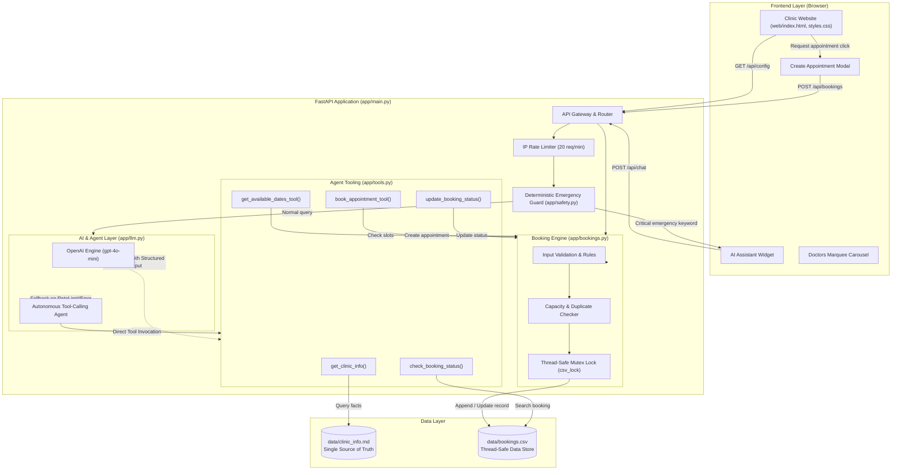

# WellCare Clinic Website & AI Assistant

A production-ready, safety-first web application for primary care clinics. Combines a modern responsive frontend with a FastAPI backend featuring dual-mode AI assistance (OpenAI Structured Outputs + Autonomous Tool-Calling Agent), an automated appointment booking system with thread-safe CSV persistence, and an animated medical team showcase.

---

## Architecture Overview

The system coordinates a vanilla HTML5/CSS3/JavaScript client with a modular FastAPI service layer, autonomous tool-calling capabilities, and deterministic safety filters.



---

## Key Features

### 1. Dual-Engine Intelligent Assistant
- **Primary Engine**: Uses OpenAI Chat Completions with structured Pydantic output schemas (`reply`, `intent`, `source`, `booking_reason`).
- **Autonomous Tool-Calling Fallback**: When OpenAI API limits or connection errors occur, the autonomous agent takes over seamlessly, using tools to fetch facts from `data/clinic_info.md` and query/update `data/bookings.csv`.
- **Direct Chat Booking**: Patients can schedule appointments directly through conversational chat (e.g. *"Book for John Doe on 2026-11-20 for check-up"*).
- **Status Inquiry & Cancellation**: Patients can check status (e.g. *"Check status of B1001"*) or request cancellation (e.g. *"Cancel booking B1001"*) via natural language.

### 2. Clinical Safety & Medical Ethics
- **Zero Medical Advice Policy**: Rejects requests for medical diagnosis, prescriptions, dosage, and treatment, directing patients to consult licensed clinicians.
- **Deterministic Emergency Interceptor**: Hardcoded regex keyword detection for critical symptoms (`chest pain`, `can't breathe`, `severe bleeding`, `stroke`) immediately returns emergency emergency instructions (`8785415621`), bypassing the LLM entirely.
- **Strict FAQ Grounding**: General questions (hours, address, preparation, services) are answered strictly from `data/clinic_info.md`.

### 3. Automated Appointment Booking Workflow
- **Interactive Modal**: The booking section opens cleanly in an accessible modal dialog when clicking *"Request appointment"* (nav, hero, doctor cards, or chat suggestion chip).
- **Hidden Background Processing**: Fields like `Booking ID` (auto-incremented), `Status` (defaulted to `Accepted`), and `Created At` (ISO timestamp) are processed in the background, keeping the user interface simple and uncluttered.
- **Strict Business Rules**:
  - Closed on weekends (Monday through Friday only).
  - Enforces daily capacity (`DAILY_CAPACITY = 8`).
  - Next available open date suggestions on capacity full (`HTTP 409`).
  - Duplicate booking prevention for identical phone and date combinations.
  - Sanitization against CSV formula injection (`=`, `+`, `-`, `@`).

### 4. Interactive Medical Team Showcase
- **Infinite Marquee Animation**: Smooth CSS continuous left-scrolling animation featuring doctor profiles with custom vector avatars, qualifications, specialties, star ratings (`★★★★★ 4.9`), review counts, and experience badges.
- **Interactive Booking**: Each doctor card includes a *"Request Appointment"* button that pre-populates the booking modal.
- **Pause on Hover**: Hovering over any doctor card pauses the marquee for easy reading.

---

## Tech Stack

| Layer | Technologies |
|---|---|
| **Backend** | Python 3.11+, FastAPI, Uvicorn, Pydantic v2, `python-dotenv` |
| **AI / Agent** | Official `openai` SDK (Structured Outputs & Tool Calling), Autonomous Fallback Agent |
| **Frontend** | Vanilla HTML5, Modern CSS3 (Grid, Flexbox, Keyframe Animations), Vanilla ES6+ JavaScript |
| **Data Storage** | Thread-safe CSV (`data/bookings.csv`), Markdown Knowledge Base (`data/clinic_info.md`) |
| **Testing** | `pytest`, `pytest-asyncio`, `httpx`, `unittest.mock` |

---

## Directory Structure

```text
├── app/
│   ├── __init__.py
│   ├── config.py           # Clinic metadata, environment variables & paths
│   ├── bookings.py         # Thread-safe booking engine & CSV mutex lock
│   ├── tools.py            # Agent tools (clinic facts retriever, CSV search/update)
│   ├── llm.py              # OpenAI client, agent tools runner & system prompts
│   ├── safety.py           # Deterministic emergency regex interceptor
│   ├── schemas.py          # Pydantic request & response models
│   └── main.py             # FastAPI REST endpoints & static file hosting
├── data/
│   ├── clinic_info.md      # Ground truth knowledge base (hours, location, services)
│   └── bookings.csv        # Appointments CSV data store
├── tests/
│   ├── test_api.py         # REST API endpoint unit & integration tests
│   ├── test_bookings.py    # Booking validation, capacity & thread safety tests
│   ├── test_chat_llm.py    # LLM structured output & agent tools tests
│   └── test_safety.py      # Emergency keyword detector tests
├── web/
│   ├── index.html          # Semantic HTML5 single-page application
│   ├── styles.css          # Responsive design, CSS animations & modal styling
│   └── app.js              # DOM logic, modal management, chat & API calls
├── logs/
│   └── app.log             # Rotating application logger
├── requirements.txt        # Python dependency manifest
├── pytest.ini              # Pytest configuration
├── PROMPTS.md              # AI system prompt version documentation
└── README.md               # Project documentation
```

---

## REST API Specification

| Method | Endpoint | Description |
|---|---|---|
| `GET` | `/api/config` | Retrieves clinic configuration (hours, phone, address, emergency number). |
| `POST` | `/api/chat` | AI chat endpoint with safety checks, tool calling, and FAQ retrieval. |
| `GET` | `/api/bookings` | Returns all appointment records from `bookings.csv`. |
| `POST` | `/api/bookings` | Creates or updates an appointment booking in `bookings.csv`. |
| `PUT` | `/api/bookings/{id}` | Updates an existing appointment booking by ID in `bookings.csv`. |

---

## Installation & Setup

### 1. Prerequisites
- **Python 3.11** or later installed.
- **Git** installed.

### 2. Clone the Repository
```bash
git clone https://github.com/<your-username>/<your-repo-name>.git
cd <your-repo-name>
```

### 3. Create and Activate Virtual Environment
```bash
# On Windows:
python -m venv venv
.\venv\Scripts\activate

# On Linux / macOS:
python3 -m venv venv
source venv/bin/activate
```

### 4. Install Dependencies
```bash
pip install -r requirements.txt
```

### 5. Configure Environment Variables
Create a `.env` file in the root directory:
```env
OPENAI_API_KEY=sk-...your-openai-api-key...
OPENAI_MODEL=gpt-4o-mini
CLINIC_NAME=WellCare
```
*(Note: If no OpenAI API key is supplied or if credits are exhausted, the built-in autonomous agent handles all clinic queries and booking requests locally without disruption).*

---

## Running the Application

Start the FastAPI development server:
```bash
uvicorn app.main:app --reload
```

Access the interfaces in your browser:
- **Clinic Website**: [http://localhost:8000/](http://localhost:8000/)
- **Interactive Swagger API Docs**: [http://localhost:8000/docs](http://localhost:8000/docs)
- **Alternative ReDoc**: [http://localhost:8000/redoc](http://localhost:8000/redoc)

---

## Running Automated Tests

Run the full automated test suite (45 unit and integration tests):
```bash
pytest -v
```

All test cases run in isolation using temporary mock copies of `bookings.csv` and mocked OpenAI calls.

---

## Booking CSV Format

The appointment schedule is persisted in `data/bookings.csv` with the following columns:

```csv
booking_id,name,phone,preferred_date,reason,status,created_at
B1001,Aisha Khan,+1-555-0101,2026-11-04,General check-up,Accepted,2026-11-01T09:12:00
B1002,Daniel Moore,+1-555-0102,2026-11-04,Flu shot,Accepted,2026-11-01T10:40:00
```

- **`booking_id`**: Incremental sequential identifier (`B1001`, `B1002`, ...).
- **`name`**: Patient full name (sanitized against formula injection).
- **`phone`**: Validated phone number.
- **`preferred_date`**: Appointment date (`YYYY-MM-DD`, weekday only).
- **`reason`**: Purpose of visit (optional).
- **`status`**: Current booking status (`Accepted`, `Pending`, `Cancelled`).
- **`created_at`**: ISO timestamp of record creation.

---

## License

This project is licensed under the MIT License.
