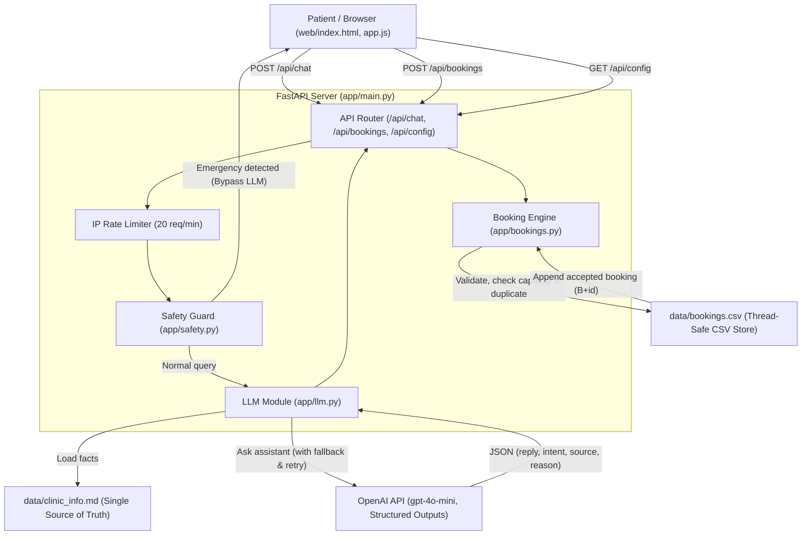

# Clinic Website with AI Assistant

A clean, production-ready one-page clinic website featuring an intelligent, safety-first AI chat assistant and an automated appointment booking request workflow.

The assistant answers patient FAQs regarding hours, location, available healthcare services, and visit preparation strictly using facts from `data/clinic_info.md`. It rejects requests for medical advice or diagnosis and detects emergencies instantly using deterministic rules that bypass the LLM.

---

## Architecture

The system coordinates a vanilla HTML5/CSS/JavaScript client with a FastAPI backend that queries OpenAI using structured JSON outputs and updates a thread-safe CSV data store.



---

## Features

- **Strict Clinic FAQ Answering**: Answers only from facts defined in `data/clinic_info.md`.
- **Zero Medical Advice Policy**: Politely declines all diagnostic, dosage, or medical treatment questions and redirects patients to consult a clinician.
- **Deterministic Emergency Interceptor**: Hardcoded regex keyword detection for critical emergencies (`chest pain`, `can't breathe`, `stroke`, etc.) returning immediate emergency warnings without calling OpenAI.
- **Automated Booking Request Workflow**: Detects booking intentions from chat or interactive UI buttons, validates dates and contact details, checks daily capacity, and records accepted appointments to `data/bookings.csv`.
- **Design & Accessibility**: Built with DM Sans typography, responsive layout, clear focus indicators, smooth animations with `prefers-reduced-motion` support, and zero `innerHTML` usage for XSS safety.

---

## Tech Stack

- **Backend**: Python 3.11+, FastAPI, Uvicorn, Pydantic v2, official `openai` Python SDK (v3.42.1+), `python-dotenv`.
- **Frontend**: Plain HTML5, CSS3, JavaScript (ES6+), DM Sans (Google Fonts with system fallback), no build steps or npm packages.
- **Testing**: `pytest`, `pytest-asyncio`, `httpx`.

---

## Setup Instructions

### 1. Prerequisites
- Python 3.11 or later installed.
- Git (optional).

### 2. Virtual Environment
```bash
python -m venv venv

# On Windows:
venv\Scripts\activate

# On Linux/macOS:
source venv/bin/activate
```

### 3. Install Dependencies
```bash
pip install -r requirements.txt
```

### 4. Configure Environment
Copy the example environment file and add your OpenAI API key:
```bash
cp .env.example .env
```
Edit `.env`:
```env
OPENAI_API_KEY=sk-...your-key...
OPENAI_MODEL=gpt-4o-mini
```

---

## Running the Application

Start the local server with Uvicorn:
```bash
uvicorn app.main:app --reload
```
Open your browser and navigate to:
- **Website & Chat**: [http://localhost:8000/](http://localhost:8000/)
- **Interactive OpenAPI Docs**: [http://localhost:8000/docs](http://localhost:8000/docs)

---

## Running Tests

Run the full automated test suite with pytest:
```bash
pytest -v
```

All tests mock external API calls and use isolated temporary copies of `bookings.csv`.

---

## How Booking Acceptance Works

When a booking request is submitted (via `POST /api/bookings` or through the interactive in-chat booking card):
1. **Format Validation**:
   - `name`: Must be between 2 and 80 characters.
   - `phone`: Must be 7 to 20 characters matching valid phone patterns (`+`, `-`, `()`, spaces, digits).
   - `preferred_date`: Must be a valid date in `YYYY-MM-DD` format.
2. **Date Rules**:
   - Must be today or a future date.
   - Cannot exceed `MAX_DAYS_AHEAD` (default 60 days).
   - Must be an open weekday (Monday through Friday). Closed on weekends.
3. **Duplicate Prevention**:
   - Rejects the request with HTTP `409 Conflict` if an accepted appointment already exists with the same normalized phone number on that date.
4. **Capacity Enforcement**:
   - Counts existing records on that date with status `Accepted` (cancelled bookings do not count).
   - If accepted bookings have reached `DAILY_CAPACITY` (default 8), the request is rejected with HTTP `409 Conflict` and returns the next 3 available open dates.
5. **Acceptance & Thread-Safe Append**:
   - Under a file mutex lock (`csv_lock`), assigns the next incremental ID (e.g. `B1021`), sanitises inputs against CSV formula injection (`=`, `+`, `-`, `@`), and appends the row with status `Accepted` and ISO timestamp to `data/bookings.csv`.

---

## Limitations

- **CSV Data Storage**: Bookings are stored in a local flat CSV file (`data/bookings.csv`). While thread-safe via in-process locks, this is intended for single-instance clinic deployments rather than distributed multi-server clusters.
- **Single Process / Server**: In-memory rate limiting and file locking are bound to the running Python process.
- **No Patient Authentication**: Bookings are identified by patient phone number and booking ID; no user accounts or passwords are implemented.
- **Placeholder Details**: Operational clinic details in `data/clinic_info.md` contain bracketed placeholders (`[Clinic name]`, `[hours]`, `[Phone number]`, etc.) to be populated by the clinic administrator.

---

## Screenshots

- **Hero & Chat Interface**: `screenshots/01-hero-chat-desktop.png`
- **FAQ Answer with Source Citation**: `screenshots/02-faq-source-citation.png`
- **Appointment Request Card**: `screenshots/03-appointment-card-inline.png`
- **Capacity Rejection with Alternative Dates**: `screenshots/04-capacity-rejection-dates.png`
- **Mobile Responsive View**: `screenshots/05-mobile-responsive.png`
